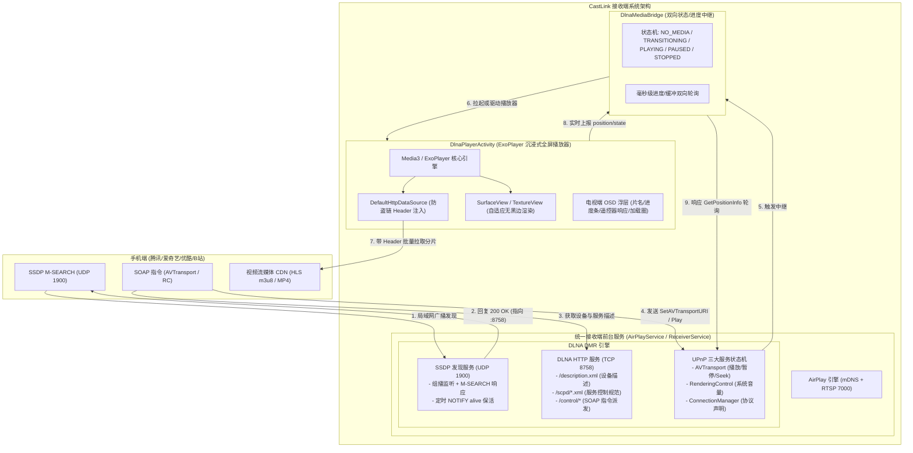

# CastLink DLNA (DMR - Digital Media Renderer) 集成方案 (v2.0 评审版)

> **设计基准决策确认**：
> - **底层播放内核**：**方案 B（ExoPlayer / Media3）** —— 深度保障国内主流流媒体（HLS/m3u8 多码率、分片自适应、防盗链 Header 动态注入、音视频格式兼容性）。
> - **后台服务托管**：**方案 A（统一前台服务）** —— 与现有 `AirPlayService` 合并托管，共用一个常驻前台服务，避免通知栏多图标混乱与进程生命周期不同步。

---

## 一、方案背景与架构全景

### 1.1 现状与技术痛点
1. **AirPlay 隔空播放局限**：
   - 现代 iOS 版本在视频 URL 投屏时会发起 `/fp-setup2` FairPlay 加密私有握手，且原生仅支持 Apple 体系生态。
   - **国内主流视频 App（腾讯视频、爱奇艺、优酷、哔哩哔哩、芒果 TV、网易云等）电视投屏核心走标准 DLNA/UPnP (DMR) 协议**，而非 AirPlay。
2. **原生 Android MediaPlayer 的流媒体缺陷**：
   - 国内流媒体视频大部分为分段 HLS (`.m3u8`)，且频繁包含广告切片、时间戳不连续 (`#EXT-X-DISCONTINUITY`)、防盗链 Token 鉴权以及动态码率自适应。
   - 系统原生 `android.media.MediaPlayer` 对多码率 HLS 的缓冲策略落后，容易出现 `error -1004`、卡顿、黑屏或 HTTP 403 无法带定制 Header 的问题。
3. **选型 ExoPlayer / Media3 的决定性优势**：
   - **强大的 HLS/DASH 引擎**：原生支持多清晰度无缝切流、分片预加载和时间戳校准。
   - **灵活的 Network Stack**：`DefaultHttpDataSource.Factory` 允许动态拦截并为每个分片注入定制 `User-Agent`、`Referer`、`Cookie` 与鉴权 Token。
   - **精准的播放控制状态回调**：`Player.Listener` 提供毫秒级时间线通知与缓冲百分比，完美映射 DLNA `GetPositionInfo` 与 `GetTransportInfo`。

---

## 二、系统架构设计



---

## 三、核心模块与关键机制设计

### 3.1 模块一：统一前台服务托管 (方案 A 落地规范)
- **服务载体**：复用现有的 [`AirPlayService`](file:///d:/codex/castlink/app/src/main/java/com/castlink/receiver/airplay/AirPlayService.kt) 前台服务。
- **生命周期编排**：
  - `onCreate()`：
    1. 启动常驻前台 Notification（通知文案升级为：“CastLink 接收服务运行中：支持隔空播放与流媒体投屏”）。
    2. 解析并保证统一设备名称（调用 [`DeviceName.resolve(this)`](file:///d:/codex/castlink/app/src/main/java/com/castlink/receiver/util/DeviceName.kt)）。
    3. 启动 AirPlay Receiver（RTSP 7000 + mDNS）。
    4. 启动 DLNA Server（SSDP UDP 1900 + HTTP 8758）。
  - `onDestroy()`：
    - 平滑释放 AirPlay 与 DLNA 服务，广播 `ssdp:byebye` 下线宣告。
- **待机页协同**：
  - [`StandbyActivity`](file:///d:/codex/castlink/app/src/main/java/com/castlink/receiver/ui/StandbyActivity.kt) 只需确保该前台服务运行即可，无需维护独立的 DLNA 进程或重复前台通知。

---

### 3.2 模块二：SSDP 发现与设备描述规范
1. **端口划分**：
   - SSDP 组播：`239.255.255.250:1900`
   - DLNA HTTP 描述与控制：`8758`（避开 8755 信令、8756 文件推送、7000 RTSP）。
2. **Android 组播锁保护**：
   - 必须通过 `WifiManager.createMulticastLock("CastLink_SSDP")` 开启组播锁，解决 TV 盒子与 Android 手机在后台休眠时底层 Wi-Fi 芯片丢弃组播包的通病。
3. **设备描述 (`/description.xml`)**：
   - 包含固定且持久化的 UDN（基于 `Settings.Secure.ANDROID_ID` 生成 UUID）。
   - 注册三大标准 UPnP 服务：
     - `AVTransport:1`：控制 URL `/control/avt`，SCPD `/scpd/avt.xml`
     - `RenderingControl:1`：控制 URL `/control/rc`，SCPD `/scpd/rc.xml`
     - `ConnectionManager:1`：控制 URL `/control/cm`，SCPD `/scpd/cm.xml`

---

### 3.3 模块三：SOAP 协议栈与国内主流 App 兼容细节
国内流媒体 App（爱优腾B）在调用 DLNA 指令时具有高度特定的时序要求：

1. **状态机瞬间反馈（爱奇艺/优酷防退出）**：
   - 手机端发出 `SetAVTransportURI` 后，紧接着调用 `Play`，并在 100ms 内发起 `GetTransportInfo`。
   - **处理机制**：收到 `SetAVTransportURI` 且 URL 校验通过后，DMR 状态立即从 `STOPPED` 转为 `TRANSITIONING`；收到 `Play` 且 ExoPlayer 正在加载时维持 `TRANSITIONING` 或切为 `PLAYING`。严禁在接收到 URL 后仍回复 `STOPPED`，否则客户端会直接弹窗“投屏失败并中断连接”。
2. **时间戳格式规范（腾讯视频进度条防卡死）**：
   - `GetPositionInfo` 中的 `TrackDuration`、`RelTime`、`AbsTime` 必须严格遵循 `HH:mm:ss` 标准三段格式（如 `00:45:12`），不得输出毫秒小数或两位表示（如 `45:12`）。
3. **DIDL-Lite 元数据深度提取**：
   - 解析 `CurrentURIMetaData` 中的 `<dc:title>`（视频标题）、`<upnp:albumArtURI>`（海报缩略图）、`<res duration="...">`（预设片长），提取后送入 OSD 浮层展示。

---

### 3.4 模块四：基于 ExoPlayer 的流媒体播放引擎 (方案 B 落地规范)

#### 1. 核心播放架构 (`DlnaPlayerActivity`)
- **播放组件**：采用 `androidx.media3.exoplayer.ExoPlayer`。
- **数据源工厂配置 (防盗链核心)**：
  ```kotlin
  val httpDataSourceFactory = DefaultHttpDataSource.Factory()
      .setAllowCrossProtocolRedirects(true)
      .setConnectTimeoutMs(15_000)
      .setReadTimeoutMs(15_000)
      .setDefaultRequestProperties(mapOf(
          "User-Agent" to "Mozilla/5.0 (Linux; Android 10; CastLink-DMR) AppleWebKit/537.36 (KHTML, like Gecko) Chrome/108.0.0.0 Mobile Safari/537.36",
          "Accept" to "*/*",
          "Referer" to buildReferer(url) // 依据域名自动补全防盗链 Referer
      ))
  val mediaSource = HlsMediaSource.Factory(httpDataSourceFactory)
      .createMediaSource(MediaItem.fromUri(uri))
  ```
- **画面渲染与尺寸适配**：
  - 针对折叠屏、便携屏及老旧电视盒子的非标准分辨率，ExoPlayer 接入 `onVideoSizeChanged` 监听，利用 `AspectRatioFrameLayout` 或 Matrix 实现等比例铺满无变形拉伸。
- **缓冲与渲染状态映射**：
  - `Player.STATE_BUFFERING` $\rightarrow$ 展示中心 Loading 圈，DMR 状态为 `TRANSITIONING`。
  - `Player.STATE_READY` $\rightarrow$ 隐藏 Loading 圈，若 `playWhenReady == true`，DMR 状态为 `PLAYING`。
  - `Player.STATE_ENDED` $\rightarrow$ DMR 状态置为 `STOPPED`，退出播放页返回待机页。

#### 2. 遥控器与 OSD 交互规范
- **确定键 (DPAD_CENTER / ENTER)**：切换播放 / 暂停，反向同步 `DlnaMediaBridge` 状态。
- **方向左/右键 (DPAD_LEFT / DPAD_RIGHT)**：快退 10 秒 / 快进 10 秒（精准 Seek 并呼出 OSD 进度条）。
- **返回键 (BACK)**：弹出快捷浮层提示或停止播放，向手机端汇报 `STOPPED` 并返回待机界面。
- **无操作自动隐藏**：OSD 控制栏在 5 秒无遥控按键后平滑淡出。

---

## 四、构建链与依赖引入方案 (`build_manual.sh` 适配)

由于 CastLink 采用基于命令行工具链的手工构建模式（`tools/build_manual.sh`），引入 ExoPlayer 需要精准控制 JAR/AAR 依赖集合，保持编译环境纯净：

### 4.1 所需依赖规范 (Media3 / ExoPlayer 核心子集)
为避免引入全套臃肿的 AndroidX，我们仅提取 ExoPlayer 播放 HLS/MP4 所必需的最小 Jar/AAR 集合：
1. `media3-common-1.x.x.jar`
2. `media3-exoplayer-1.x.x.jar`
3. `media3-exoplayer-hls-1.x.x.jar`
4. `media3-datasource-1.x.x.jar`
5. `media3-decoder-1.x.x.jar`

### 4.2 构建脚本改造点
在 `tools/build_manual.sh` 中：
1. 在 `M2` 仓库路径中定义 `EXO_CP` 并追加至编译类路径 `APP_CP`：
   ```bash
   APP_CP="$AJAR:$STDLIB:$ZXING:$COROUTINES_CORE:$COROUTINES_ANDROID:$BCPROV:$DDPLIST:$EXO_CP"
   ```
2. 在 D8 打包步骤中，将 ExoPlayer 相关的 Jar 文件一并传入 D8 进行 Dexing 与核心类脱糖（Desugaring）。

---

## 五、代码模块结构规划

所有新增代码严格归整于 `com.castlink.receiver.dlna.*` 包内，绝不对现有自有协议逻辑产生任何侵入：

```
app/src/main/java/com/castlink/receiver/dlna/
├── DlnaServer.kt               // DLNA 总控制器 (组合 SsdpServer 与 DlnaHttpServer)
├── DlnaMediaBridge.kt          // SOAP 控制层与 ExoPlayer 播放器双向中继
├── ssdp/
│   ├── SsdpServer.kt           // UDP 1900 组播监听、过滤与响应
│   └── SsdpPacket.kt           // SSDP 报文协议编解码器
├── server/
│   ├── DlnaHttpServer.kt       // 轻量 HTTP 服务 (端口 8758)
│   ├── DeviceDescription.kt    // /description.xml 动态生成
│   └── ScpdDescriptions.kt     // AVTransport, RC, CM 服务描述 XML 模版
├── service/
│   ├── SoapDispatcher.kt       // SOAPAction 路由与分发
│   ├── AvTransportService.kt   // 播放传输状态机核心 (Play/Pause/Seek/Info)
│   ├── RenderingControlService.kt // 系统音量与静音调谐
│   └── ConnectionManagerService.kt// 媒体协议 MIME 支持能力声明
└── ui/
    └── DlnaPlayerActivity.kt   // 基于 ExoPlayer 的全屏播放器与 OSD 交互
```

---

## 六、实施与测试验证计划

| 阶段 | 实施任务 | 验证手段与验收标准 |
| :--- | :--- | :--- |
| **阶段 1：服务托管与发现层** | 1. 改造 `AirPlayService`，拉起 `DlnaServer`；<br/>2. 实现 `SsdpServer` 与 `DlnaHttpServer` (:8758)。 | 手机连接同一 Wi-Fi，打开腾讯视频/爱奇艺投屏列表，能稳定发现 `CastLink-TV` 设备。 |
| **阶段 2：SOAP 控制协议解析** | 1. 实现 `SoapDispatcher` 与 `AvTransportService`；<br/>2. 支持 `SetAVTransportURI` 与参数解析。 | 手机点击投屏后，控制台精准打印解析出的视频 URL、片名与分辨率信息。 |
| **阶段 3：ExoPlayer 播放内核落地** | 1. 集成 ExoPlayer/Media3 HLS 流媒体播放；<br/>2. 注入防盗链 Request Headers；<br/>3. 实现 `DlnaPlayerActivity` 全屏播放。 | 腾讯/爱优腾B等主流视频成功加载出画面与声音，播放流畅无黑边。 |
| **阶段 4：进度同步与双向遥控** | 1. 完善 `GetPositionInfo` 进度轮询；<br/>2. 接入遥控器按键（快进、暂停、退出）。 | 手机端拖动进度条，电视同步 Seek；电视遥控器暂停，手机端状态实时切为暂停。 |
